# Bud Jet

Aplicación Android para llevar el control de tus gastos, ingresos, presupuestos y objetivos de ahorro. Diseño sobrio, cálido y editorial, con tres gamas de color.

> Estado: **boceto funcional v0.4.1**. Datos locales, copia de seguridad, desbloqueo biométrico, saldo inicial editable y movimientos programados.

| Resumen | Objetivos | Movimientos |
|---|---|---|
| 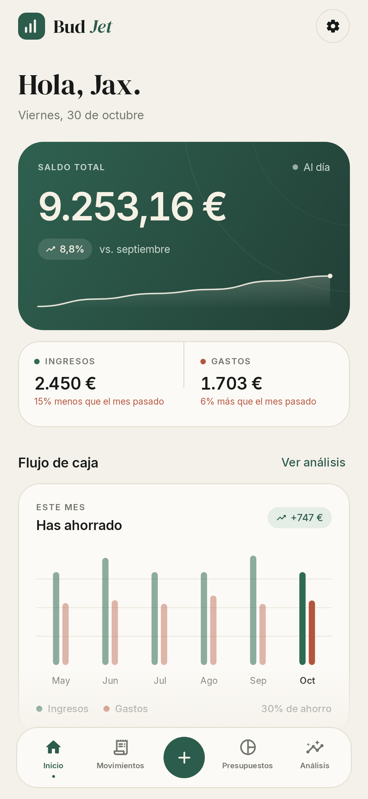 | 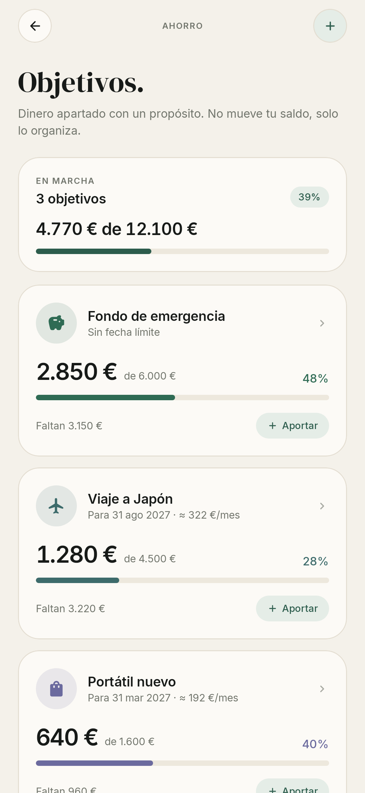 | 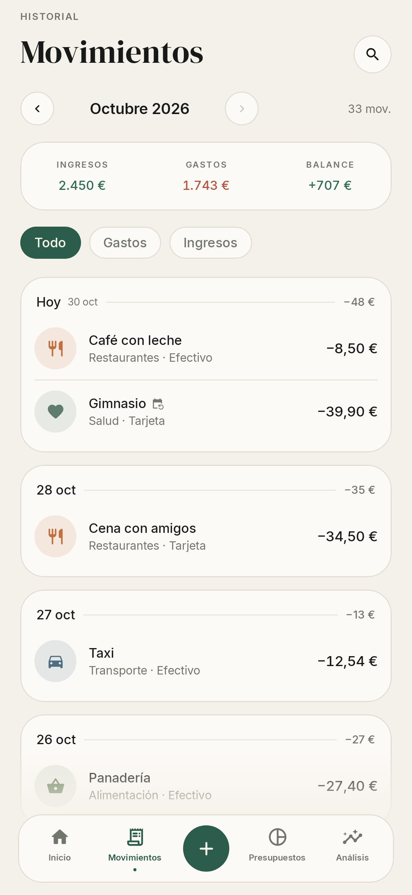 |

| Presupuestos | Análisis | Detalle de categoría |
|---|---|---|
| 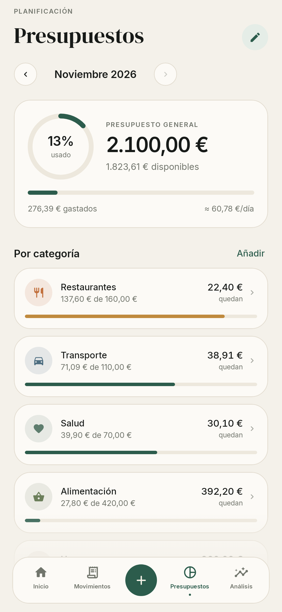 | 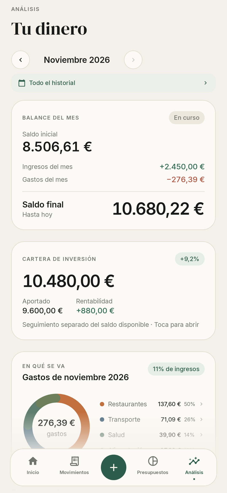 | 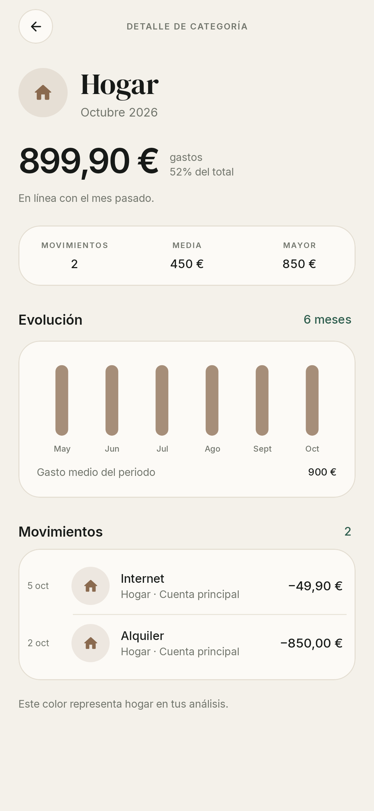 |

| Añadir movimiento | Movimientos recurrentes | Ajustes |
|---|---|---|
|  | 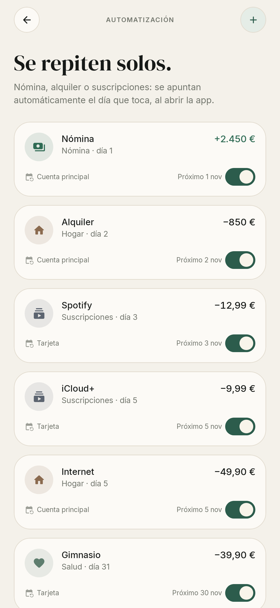 | 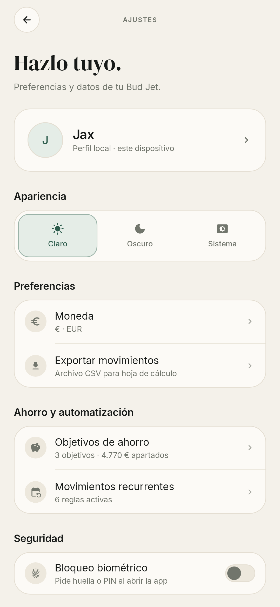 |

| Datos y copia | Modo oscuro | Empezar de cero |
|---|---|---|
| 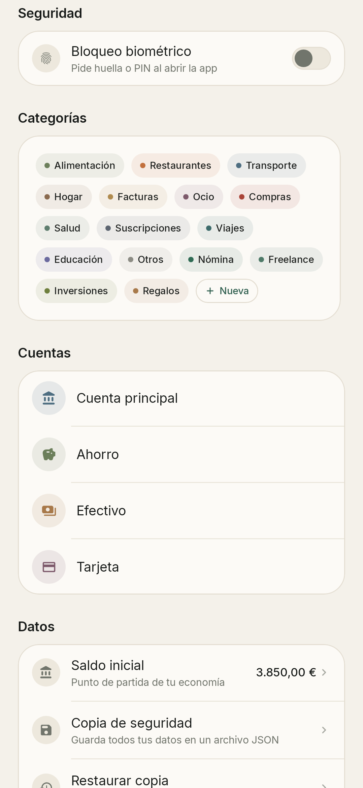 | 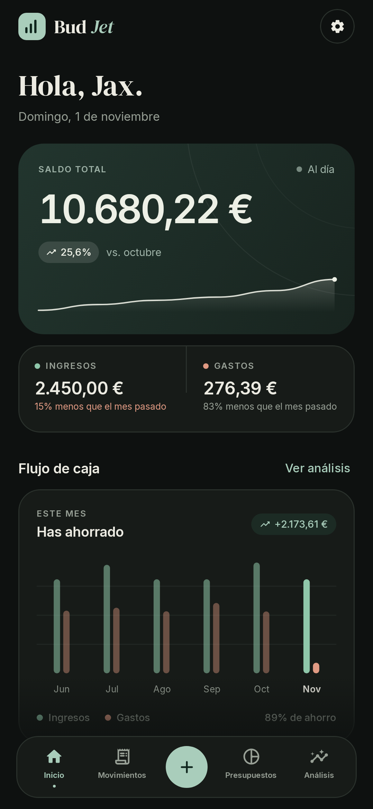 | 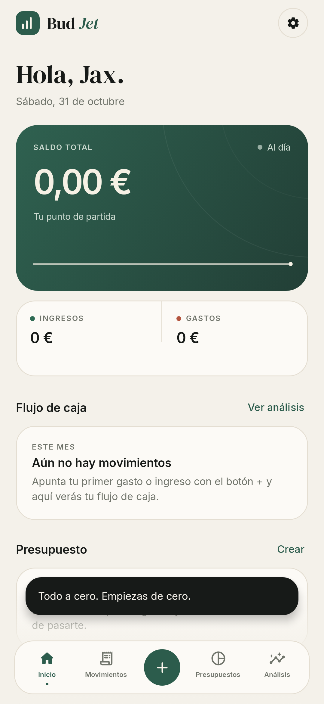 |

| Bloqueo biométrico |
|---|
|  |

## Gamas de color

Se eligen en **Ajustes → Apariencia**, debajo de Claro/Oscuro/Sistema. Cada gama tiene variante clara y oscura:

| Business | Navy | Boss |
|---|---|---|
|  | 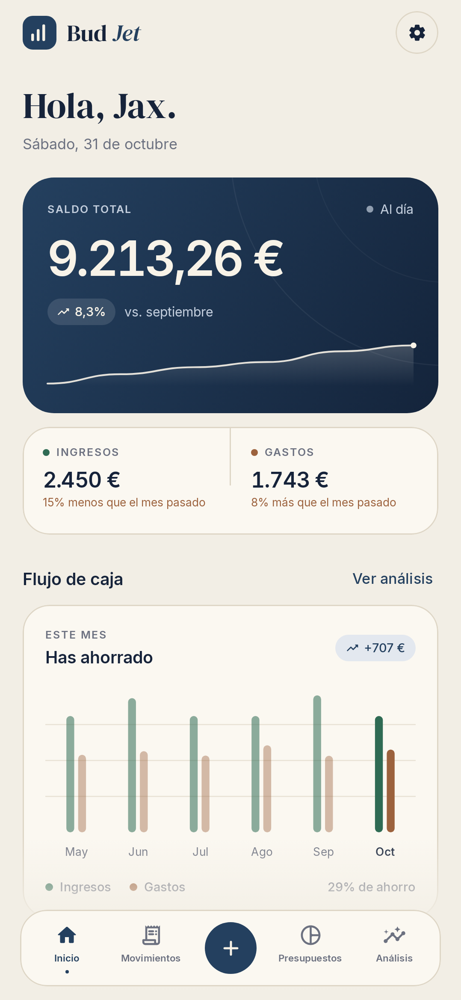 | 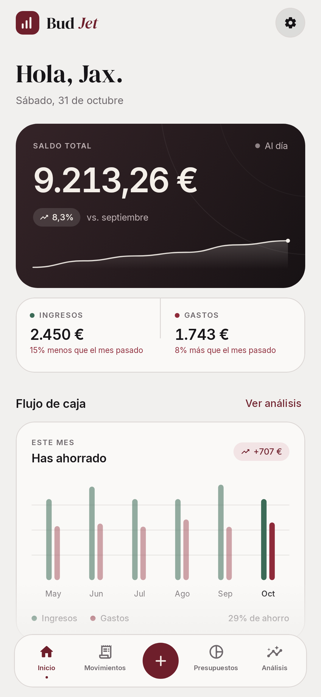 |
| Papel, verde pino y terracota. | Beige, azul marino y marrón. | Gris/negro y rojo vino. |

Las categorías conservan sus colores en las tres gamas para no perder identidad; el verde sigue significando ingreso y el rojo/tierra gasto.

## Qué incluye

- **Inicio** — saldo total, evolución de 6 meses, ingresos/gastos del mes, presupuesto, objetivos y últimos movimientos.
- **Movimientos** — historial agrupado por día, filtros, búsqueda, edición y borrado con deshacer.
- **Presupuestos** — límite mensual general y por categoría, con ritmo de gasto diario.
- **Análisis** — desglose por categorías, comparativa de 6 meses, estadísticas e ideas automáticas.
- **Detalle de categoría** — toca un segmento del donut o su leyenda para ver la evolución, las métricas y los movimientos de esa categoría.
- **Objetivos de ahorro** — metas, aportaciones/retiradas, progreso y sugerencia mensual. Es una “hucha virtual”.
- **Movimientos recurrentes** — nómina, alquiler o suscripciones mensuales; se apuntan solos al abrir la app, se pueden pausar y editar.
- **Movimientos programados** — puedes fechar un ingreso o gasto en el futuro: se guarda y se muestra en la lista con la marca “Programado”, pero no afecta al saldo, resumen, presupuestos ni análisis hasta ese día.
- **Copia de seguridad** — exporta todo a un JSON versionado y restáuralo desde el selector de Android, con validación y resumen antes de sustituir.
- **Saldo inicial** — visible y editable en Ajustes → Datos. Ya no hay una cifra oculta de demo.
- **Empezar de cero** — borra movimientos, presupuestos, objetivos y recurrentes; deja el saldo inicial a 0 y conserva categorías, cuentas y apariencia.
- **Bloqueo biométrico** — huella o PIN al abrir y tras 30 segundos en segundo plano, con “Probar desbloqueo”.
- **Ajustes** — nombre, moneda (EUR/USD/GBP/MXN), tema, gama de color, categorías, cuentas y exportación CSV.

Todo se guarda en el dispositivo (`files/budjet.json`); no hay cuentas ni nube.

## Stack

- Kotlin + Jetpack Compose (Material 3)
- ViewModel + StateFlow
- Kotlinx Serialization para persistencia y backups
- AndroidX Biometric + FragmentActivity
- Gradle 9.8 · AGP 9.4 · compileSdk 37 · targetSdk 37 · minSdk 26
- Tipografías DM Serif Display + Inter (SIL OFL)

## Compilar

```bash
./gradlew :app:assembleDebug
```

APK en `app/build/outputs/apk/debug/app-debug.apk`.

Requiere JDK 17+ y Android SDK 37.

## Probar el boceto

1. Instala `BudJet-0.4.1-boceto.apk` en un Android 8.0 o superior.
2. La app arranca con datos de ejemplo de los últimos 6 meses.
3. Para empezar con todo a cero: **Ajustes → Datos → Empezar de cero**. El saldo total, ingresos, gastos, presupuestos, objetivos y recurrentes quedarán a 0. Si quieres registrar el dinero que ya tenías, cambia **Saldo inicial** en la misma pantalla.
4. Prueba las gamas **Business / Navy / Boss** en **Ajustes → Apariencia**.
5. Exporta una copia en **Ajustes → Datos → Copia de seguridad** y restáurala.
6. El bloqueo biométrico se activa en **Ajustes → Seguridad**; sigue [`docs/BIOMETRIC_TEST.md`](docs/BIOMETRIC_TEST.md).

La APK de la raíz es una build *debug* firmada con la clave de desarrollo: sirve para probar, no para publicar en Google Play.

## Tests

```bash
./gradlew :app:testDebugUnitTest
./gradlew :app:lintDebug
```

- **39 tests de lógica** — finanzas, movimientos futuros, recurrencias, objetivos, backup/importación, migración del saldo oculto, reseteo y biometría.
- **2 tests de captura** con Robolectric/Roborazzi que renderizan 21 pantallas.
- **Lint: 0 errores**.

## Estructura

```
app/src/main/java/com/budjet/app/
├── data/         modelos, demo, recurrencias, backup, migraciones y cálculos
├── ui/           navegación, ViewModel, pantallas y componentes
├── ui/theme/     paletas Business/Navy/Boss, tipografía y tema
└── util/         formatos, CSV y autenticación biométrica
```

## Límites conocidos del boceto

- Las recurrencias son mensuales y se procesan al abrir la app; si no abres la app durante un mes, ese cargo no se genera.
- Los movimientos futuros aparecen en la lista del mes en que caen y se marcan como “Programado”; no cuentan hasta su fecha.
- Los objetivos son una asignación virtual: no mueven dinero entre cuentas ni descuentan del saldo.
- La copia de seguridad **sustituye** todos los datos; todavía no hay fusión ni importación incremental.
- El archivo de copia es un JSON legible, no cifrado: guárdalo en un lugar seguro.
- El bloqueo biométrico está integrado y probado en JVM/UI; falta la firma en un dispositivo real.
- Sin copia en la nube ni sincronización entre dispositivos.

## Próximos pasos

- [ ] Validar la checklist biométrica en tu móvil (BUD-26).
- [ ] Notificaciones de presupuesto y cargos recurrentes (BUD-2).
- [ ] Recurrencias semanales/anuales (BUD-10).
- [ ] Aportaciones automáticas a objetivos (BUD-14).
- [ ] Copia cifrada y copia automática.
- [ ] Widget.

El backlog está creado en Jira:

- Proyecto: [BUD · Bud Jet](https://jaxsullivan7.atlassian.net/jira/software/projects/BUD/summary)
- 5 épicas (BUD-1, BUD-3, BUD-4, BUD-5, BUD-6) y 24 historias/tareas.
- Mapa de claves: [`docs/jira-created.md`](docs/jira-created.md).
- Snapshot importable: [`docs/jira-import.csv`](docs/jira-import.csv).
