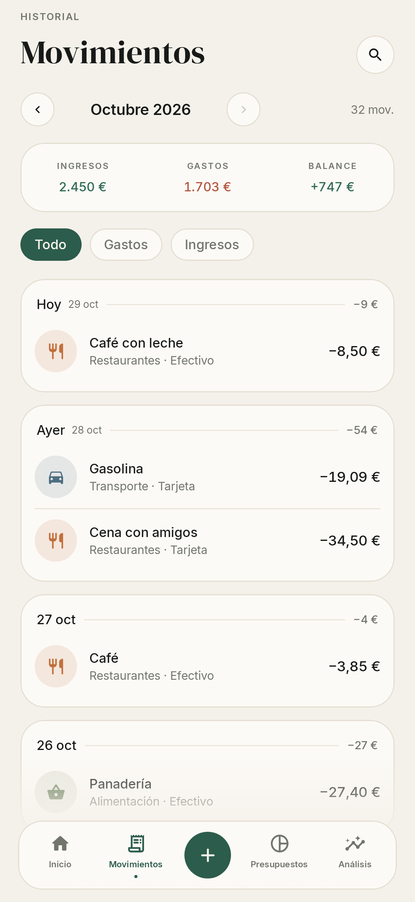
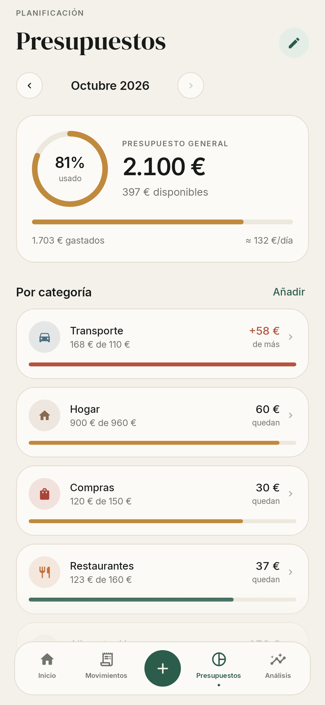
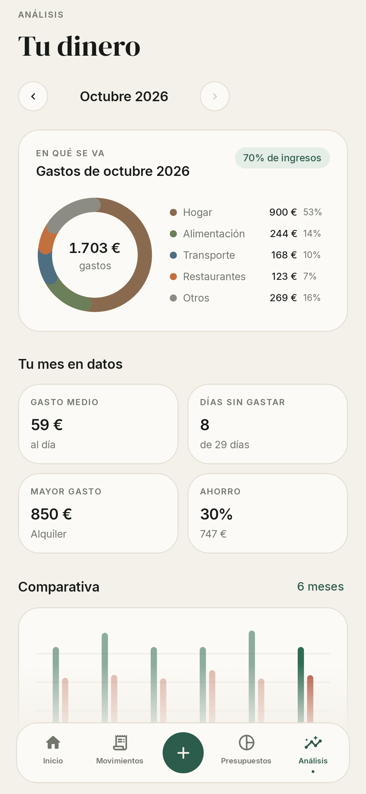
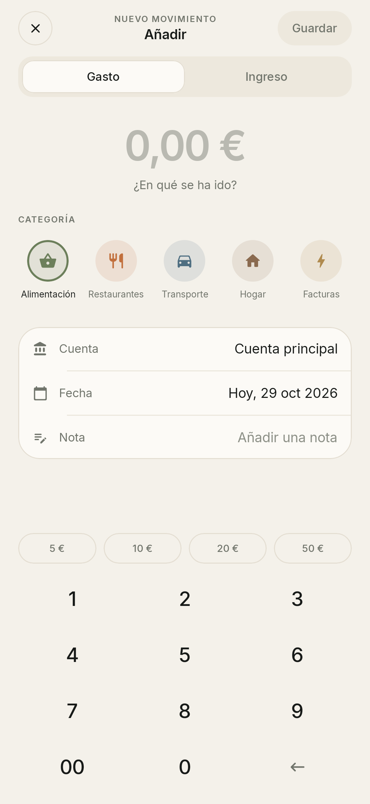
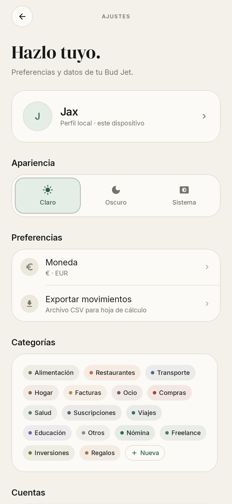
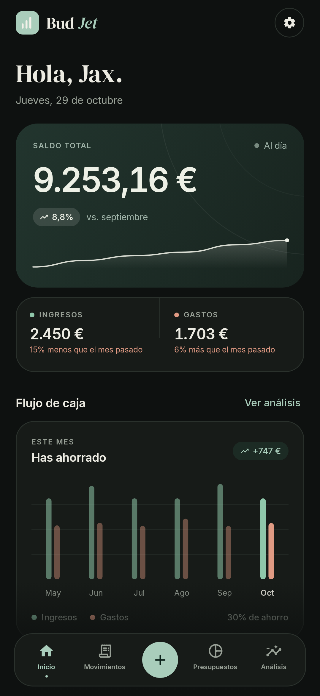

# Bud Jet

Aplicación Android para llevar el control de tus gastos, ingresos y presupuestos personales. Diseño sobrio, cálido y editorial: papel, tinta y verde pino.

> Estado: **boceto funcional v0.1.0**. Datos locales de demostración incluidos.

| Resumen | Movimientos | Presupuestos |
|---|---|---|
|  |  |  |

| Análisis | Añadir movimiento | Ajustes |
|---|---|---|
|  |  |  |

| Modo oscuro |
|---|
|  |

## Qué incluye

- **Inicio** — saldo total, evolución de 6 meses, ingresos/gastos del mes, presupuesto y últimos movimientos.
- **Movimientos** — historial agrupado por día, filtros, búsqueda, edición y borrado con deshacer.
- **Presupuestos** — límite mensual general y por categoría, con ritmo de gasto diario.
- **Análisis** — desglose por categorías, comparativa de 6 meses, estadísticas e ideas automáticas.
- **Ajustes** — nombre, moneda (EUR/USD/GBP/MXN), tema claro/oscuro/sistema, categorías, cuentas y exportación CSV.
- **Añadir movimiento** — teclado numérico propio, importes rápidos, categorías, cuenta, fecha y nota.

Todo se guarda en el dispositivo (`files/budjet.json`); no hay cuentas ni nube.

## Stack

- Kotlin + Jetpack Compose (Material 3)
- ViewModel + StateFlow
- Kotlinx Serialization para persistencia local
- Gradle 9.8 · AGP 9.4 · compileSdk 37 · minSdk 26
- Tipografías DM Serif Display + Inter (SIL OFL)

## Compilar

```bash
./gradlew :app:assembleDebug
```

APK en `app/build/outputs/apk/debug/app-debug.apk`.

Requiere JDK 17+ y Android SDK 37.

## Tests

```bash
./gradlew :app:testDebugUnitTest
```

- `FinanceTest` — cálculos de balance, totales, presupuesto y reparto por categorías.
- `ScreenshotTest` — renderiza las pantallas reales con Robolectric y guarda capturas en `app/build/screenshots/`.

## Estructura

```
app/src/main/java/com/budjet/app/
├── data/         modelos, demo, repositorio y cálculos financieros
├── ui/           navegación, ViewModel, pantallas y componentes
├── ui/theme/     paleta, tipografía y tema
└── util/         formato de importes, fechas y textos
```

## Próximos pasos

- [ ] Movimientos recurrentes y suscripciones
- [ ] Objetivos de ahorro
- [ ] Gráficas interactivas con detalle por categoría
- [ ] Copia de seguridad / importación CSV
- [ ] Widget y notificaciones de presupuesto

El backlog priorizado está en [`docs/BACKLOG.md`](docs/BACKLOG.md).
