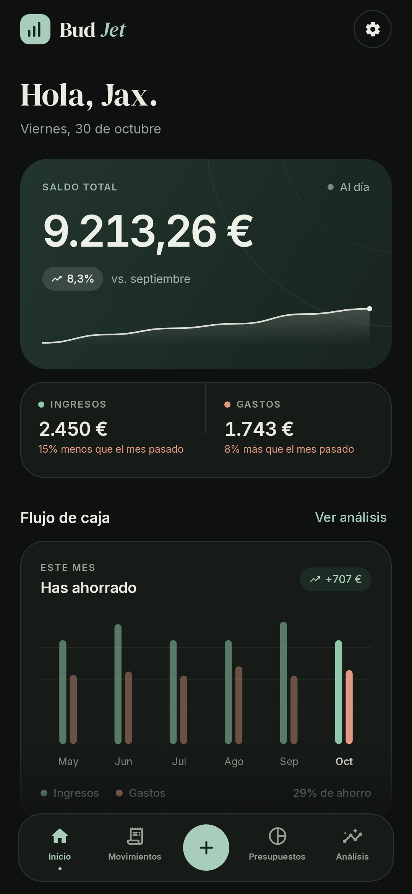
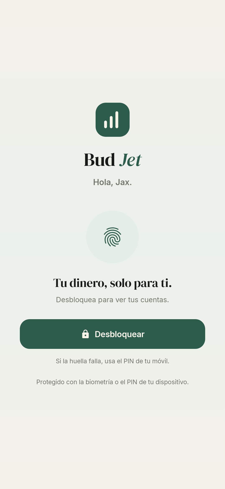

# Bud Jet

Aplicación Android para llevar el control de tus gastos, ingresos, presupuestos y objetivos de ahorro. Diseño sobrio, cálido y editorial: papel, tinta y verde pino.

> Estado: **boceto funcional v0.2.0**. Datos locales de demostración incluidos.

| Resumen | Objetivos | Movimientos |
|---|---|---|
|  |  |  |

| Presupuestos | Análisis | Detalle de categoría |
|---|---|---|
|  |  |  |

| Añadir movimiento | Movimientos recurrentes | Ajustes |
|---|---|---|
|  |  |  |

| Modo oscuro | Bloqueo biométrico |
|---|---|
|  |  |

## Qué incluye

- **Inicio** — saldo total, evolución de 6 meses, ingresos/gastos del mes, presupuesto, objetivos y últimos movimientos.
- **Movimientos** — historial agrupado por día, filtros, búsqueda, edición y borrado con deshacer.
- **Presupuestos** — límite mensual general y por categoría, con ritmo de gasto diario.
- **Análisis** — desglose por categorías, comparativa de 6 meses, estadísticas e ideas automáticas.
- **Detalle de categoría** — toca un segmento del donut o su leyenda para ver la evolución, las métricas y los movimientos de esa categoría; desde ahí puedes editar cada gasto.
- **Objetivos de ahorro** — crea metas, aporta o retira dinero y consulta el progreso y la sugerencia mensual según la fecha límite. Es una “hucha virtual”: organiza tu ahorro sin mover el saldo.
- **Movimientos recurrentes** — nómina, alquiler o suscripciones mensuales; se apuntan solos al abrir la app el día que toca, se pueden pausar y editar.
- **Ajustes** — nombre, moneda (EUR/USD/GBP/MXN), tema claro/oscuro/sistema, categorías, cuentas y exportación CSV.
- **Bloqueo biométrico** — pide huella o PIN al abrir la app y al volver tras más de 30 segundos en segundo plano.
- **Añadir movimiento** — teclado numérico propio, importes rápidos, categorías, cuenta, fecha y nota.

Todo se guarda en el dispositivo (`files/budjet.json`); no hay cuentas ni nube.

## Stack

- Kotlin + Jetpack Compose (Material 3)
- ViewModel + StateFlow
- Kotlinx Serialization para persistencia local
- AndroidX Biometric + FragmentActivity
- Gradle 9.8 · AGP 9.4 · compileSdk 37 · targetSdk 37 · minSdk 26
- Tipografías DM Serif Display + Inter (SIL OFL)

## Compilar

```bash
./gradlew :app:assembleDebug
```

APK en `app/build/outputs/apk/debug/app-debug.apk`.

Requiere JDK 17+ y Android SDK 37.

## Probar el boceto

1. Instala `BudJet-0.2.0-boceto.apk` en un Android 8.0 o superior (o compila con Gradle).
2. La app arranca con datos de ejemplo de los últimos 6 meses para que puedas moverte por todas las pantallas.
3. En **Ajustes → Datos** puedes restaurar el ejemplo o borrar los movimientos y empezar de cero.
4. El bloqueo biométrico se activa desde **Ajustes → Seguridad**; usa la huella o el PIN del dispositivo.

La APK de la raíz es una build *debug* firmada con la clave de desarrollo: sirve para probar, no para publicar en Google Play.

## Tests

```bash
./gradlew :app:testDebugUnitTest
./gradlew :app:lintDebug
```

- **19 tests de lógica** — balance, totales, presupuestos, reparto por categorías, recurrencias (fin de mes, pausas, duplicados) y objetivos.
- **Capturas reales con Robolectric/Roborazzi** — renderizan la app completa y las nuevas pantallas en `app/build/screenshots/`.
- **Lint: 0 errores**.

## Estructura

```
app/src/main/java/com/budjet/app/
├── data/         modelos, demo, recurrencias, repositorio y cálculos
├── ui/           navegación, ViewModel, pantallas y componentes
├── ui/theme/     paleta, tipografía y tema
└── util/         formatos, CSV y autenticación biométrica
```

## Límites conocidos del boceto

- Las recurrencias son mensuales y se procesan al abrir la app; si no abres la app durante un mes, ese cargo no se genera.
- Los objetivos son una asignación virtual: no mueven dinero entre cuentas ni descuentan del saldo.
- La autenticación biométrica necesita un dispositivo real con huella/PIN configurados; en el emulador o en Robolectric solo se valida la interfaz.
- Sin copia de seguridad en la nube ni sincronización entre dispositivos.

## Próximos pasos

- [ ] Recurrencias semanales/anuales y avisos de próximos cargos
- [ ] Aportaciones automáticas a objetivos
- [ ] Objetivos vinculados a una cuenta
- [ ] Notificaciones de presupuesto y de cargos
- [ ] Copia de seguridad / importación CSV
- [ ] Widget y notificaciones

El backlog priorizado está en [`docs/BACKLOG.md`](docs/BACKLOG.md) y **ya está creado en Jira**:

- Proyecto: [BUD · Bud Jet](https://jaxsullivan7.atlassian.net/jira/software/projects/BUD/summary)
- 5 épicas (BUD-1, BUD-3, BUD-4, BUD-5, BUD-6) y 24 historias/tareas (BUD-2, BUD-7…BUD-29).
- Mapa de claves: [`docs/jira-created.md`](docs/jira-created.md).
- Snapshot importable: [`docs/jira-import.csv`](docs/jira-import.csv).
